# TP : Event Sourcing et CQRS avec Spring Boot et Axon Framework

##  Objectif du TP
Ce TP met en œuvre les patterns **CQRS** (Command Query Responsibility Segregation) et **Event Sourcing** au sein d'un microservice de gestion de comptes bancaires. L'architecture est divisée en deux parties distinctes :
*   **Write Side (Command)** : Traite les commandes, valide les règles métier via des Agrégats et stocke les événements.
*   **Read Side (Query)** : Projette les événements dans une base de données relationnelle (PostgreSQL) optimisée pour la lecture.

---

##  Configuration et Dépendances
Création du projet Spring Boot (Java 21) avec les dépendances nécessaires : Spring Web, Spring Data JPA, PostgreSQL, Lombok, et le framework **Axon** pour la gestion des commandes et des événements.

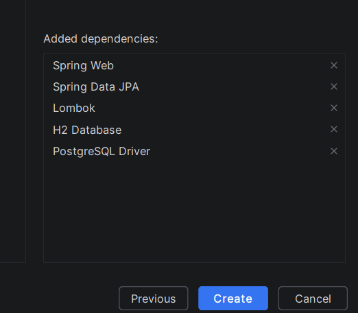

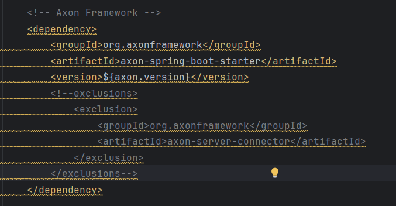

---

##  Partie 1 : Write Side (Côté Commande)

### 1. Envoi de commandes (Command Gateway)
Le contrôleur reçoit les requêtes HTTP (DTOs), les transforme en **Commandes** et les dispatche via le `CommandGateway`.

* Tentative d'envoi d'une commande sans qu'un Handler (Agrégat) ne soit souscrit pour la traiter.

    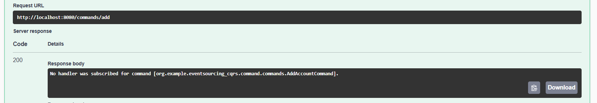

*  Une fois l'agrégat créé, la commande est traitée et retourne l'identifiant unique (UUID) du compte généré.

    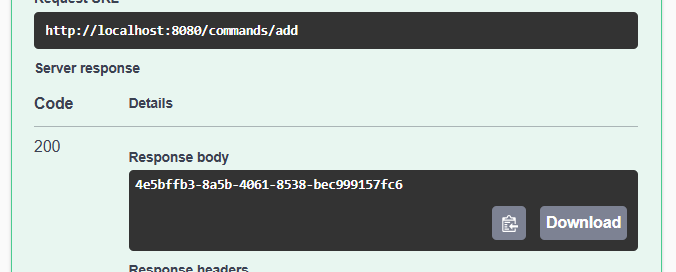

*   **Vérification dans la base H2 :**
nous vérifions que l'événement a bien été enregistré. Axon crée automatiquement une table `domain_event_entry` dans la base en mémoire pour stocker l'historique de tous les événements générés par les agrégats.

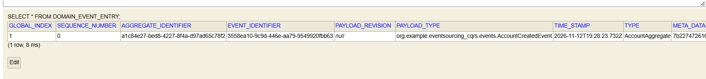

### 2. Infrastructure (Docker & PostgreSQL)
Pour un environnement réaliste, nous passons d'une base H2 en mémoire à une base **PostgreSQL** démarrée via Docker Compose.

*   **Lancement des conteneurs** : Démarrage réussi de PostgreSQL et PGAdmin.

    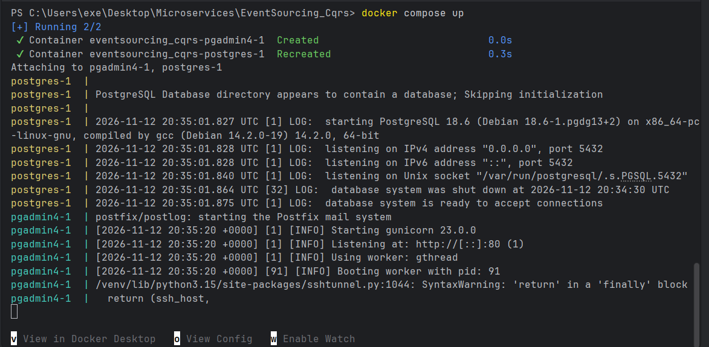

*   **Connexion à la base** : Configuration de la source de données dans l'IDE/PGAdmin.

    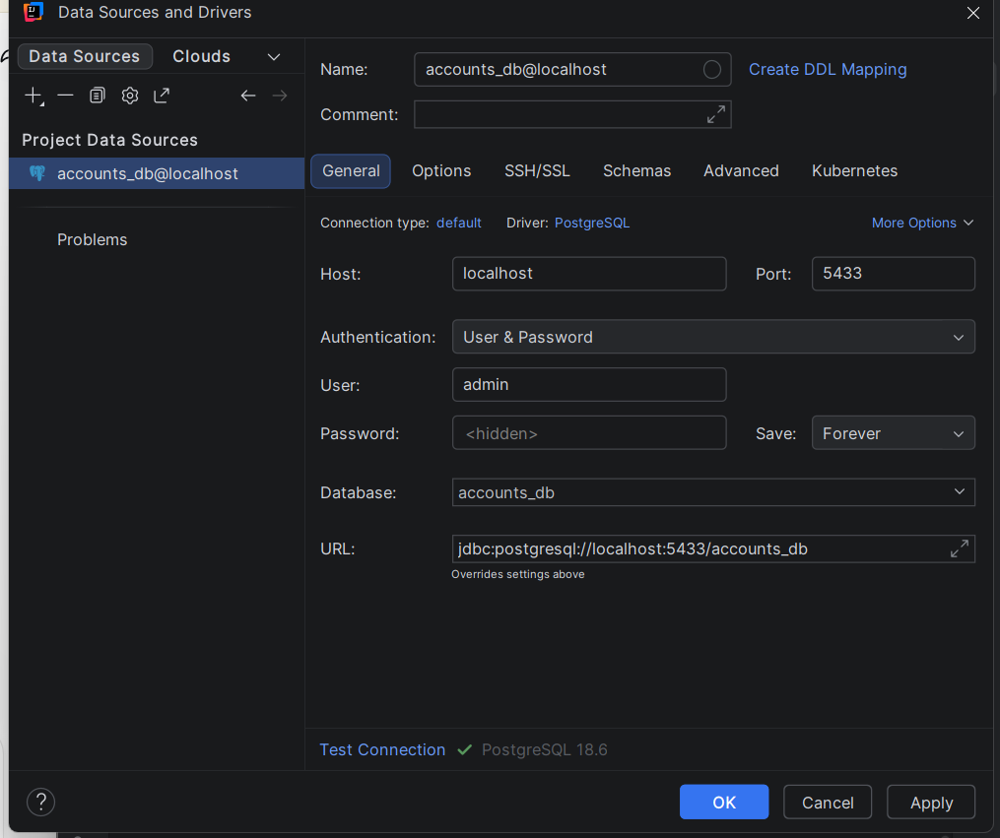

### 3. Event Store (Stockage des événements)

*    Visualisation de la table des événements via postgres .

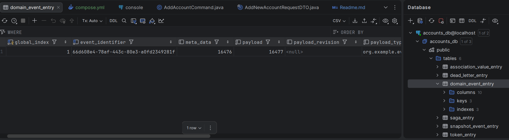

*   Requête API pour récupérer l'historique des événements liés à un compte spécifique.

    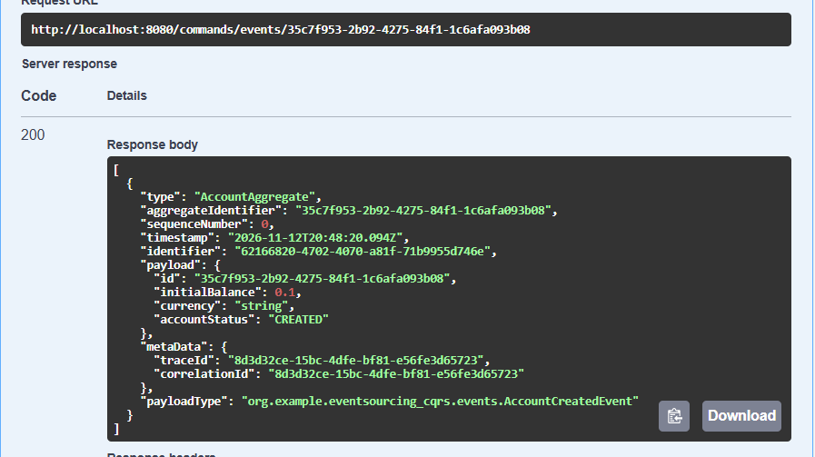

*    Visualisation des  événements via PGAdmin.

   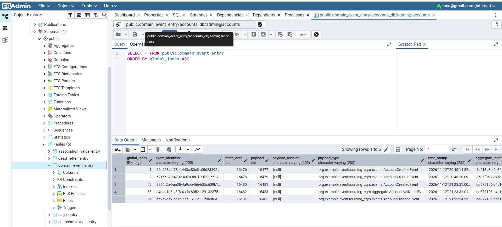

### 4. Exécution des Commandes
On a ajouté d'autres commandes qui sont traitées par l'`AccountAggregate`. L'agrégat vérifie les règles métier, émet des événements, les stocke dans l'Event Store (via `@CommandHandler`), et met à jour son état interne (via `@EventSourcingHandler`).

*   **Créditer un compte** :

    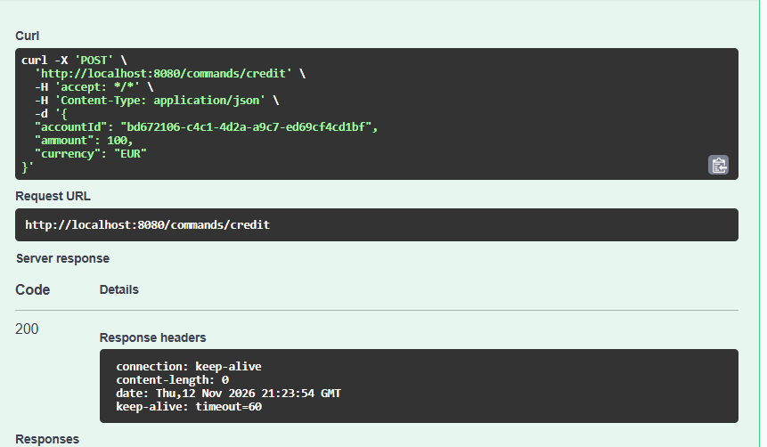

*   **Débiter un compte** :

    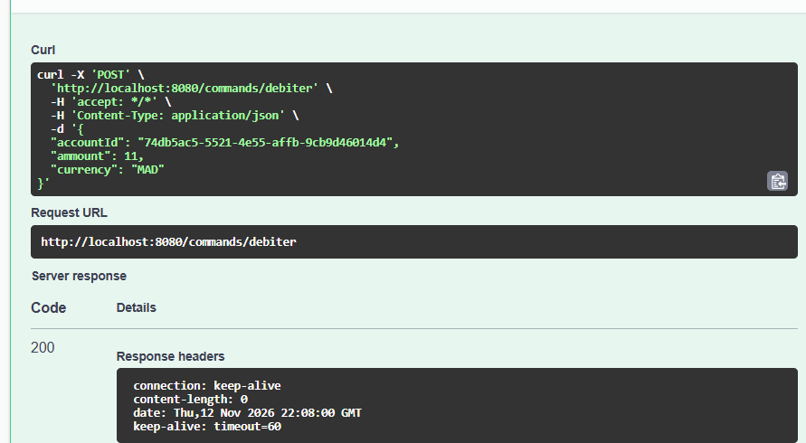

*   **Changer le statut du compte** (ex: BLOCKED) :

    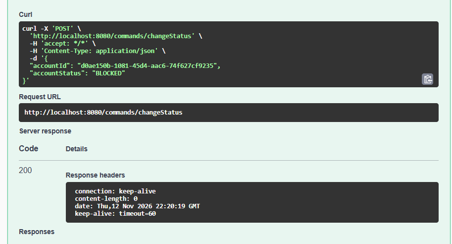

---

##  Partie 2 : Read Side (Côté Requête)

Le Read Side (ou Query Side) est responsable de la lecture des données. Pour cela, nous avons mis en place des **Event Handlers** (Projectors) qui écoutent les événements émis par le Write Side. Une fois un événement capté, le handler met à jour le modèle de lecture (Read Model) dans une base de données relationnelle (PostgreSQL) via des Repositories. Enfin, des `Queries` et `QueryHandlers` sont créés pour interroger ces données .

### 1. Modèle de lecture (Base de données)
Les événements sont projetés dans des tables relationnelles optimisées pour la consultation rapide.

*   **Table `account`** : Représente l'état actuel du compte (solde, devise, statut, date de création).
    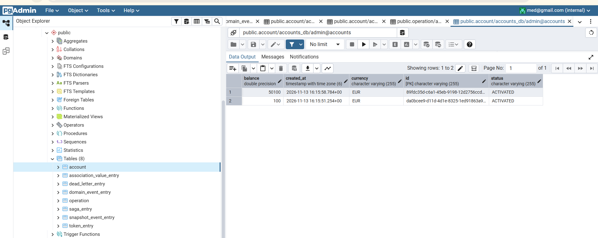
*   **Table `operation`** : Historique des opérations (CREDIT, DEBIT) liées à un compte pour permettre la génération de relevés.
    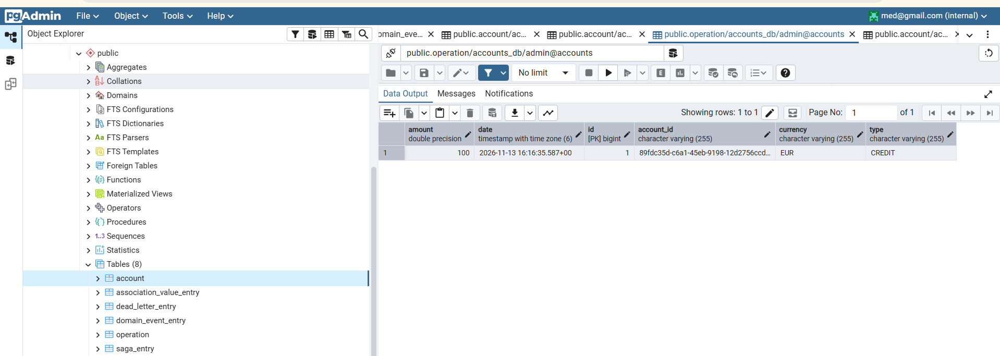

### 2. API de consultation (Queries & Query Handlers)
Les contrôleurs de requête exposent les données du Read Model sous format JSON via des endpoints REST classiques.

*   **Liste des comptes** : Récupération de tous les comptes existants.

    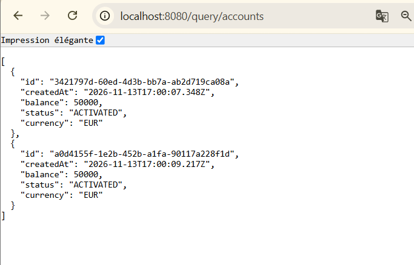

*   **Relevé de compte (Account Statement)** : Récupération des informations d'un compte spécifique et de la liste détaillée de ses opérations associées.

    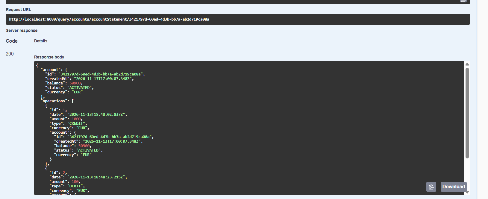

### 3. Suivi temps réel (Streaming)
Pour observer les modifications du compte en temps réel au fur et à mesure que les événements sont projetés, une API de streaming (Server-Sent Events - SSE) est exposée.
*   **Endpoint de suivi** : Permet de voir les nouvelles opérations s'afficher en direct.

    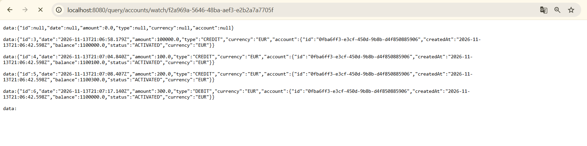